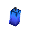
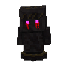
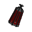

# Ritual at Blacktide Isle

### Hytale ModJam Minigame Submission

## Description

**Ritual at Blacktide Isle** is a short horror minigame set in a cursed fishing village on an island.
You start in basement of a church and enter the village to search for ritual objects while avoiding a hostile deep-sea creature. Bring the objects back one at a time, place them on the ritual pedestal, and complete the ritual before time runs out.

## How to Play

1. Download the `.jar` file and put it into your Hytale `mods` folder.
2. Start the game and join your world.
3. Start the minigame with the `/start` command or by pressing the start button.
4. Explore the village and search for the four ritual objects.
5. You can only carry **one ritual object at a time**.
6. Return each object to the ritual pedestal.
7. Place all four objects before the timer runs out to complete the ritual.

## Ritual Objects to Find

Look for these four objects hidden around the map:

| Object                 |                                              Icon                                              |
| :--------------------- |:----------------------------------------------------------------------------------------------:|
| Ritual Ghost Candle    |  |
| Ritual Blood Effigy    |           |
| Ritual Active Pentacle |     |
| Ritual Soul Lantern    |           |

## Features

* Custom horror minigame loop
* Instanced game world
* Multiplayer support
* Custom ritual objects
* Custom monster entity
* Custom fishing village map
* Timer-based win/lose condition

## Authors

| Name / GitHub                                    | Role                  |
| :----------------------------------------------- | :-------------------- |
| [@Del]()                                         | Designer, Map Builder |
| [@Moxinat](https://github.com/Moxinat)           | Designer, Developer   |
| [@Countdown](https://github.com/Countdown54321)  | Developer             |
| [@NoctuaAstrum](https://github.com/NoctuaAstrum) | 3D Artist, Developer  |
